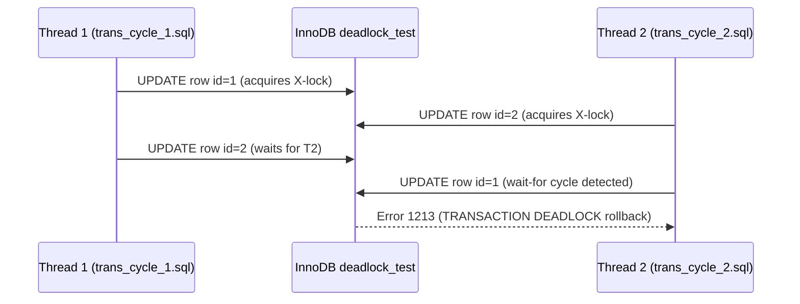

# Tutorial 3: Concurrency and Benchmarking Lab

> **Learning Goal:** Measure query throughput with `make bench`, simulate InnoDB deadlocks
> (`make test-data TEST=deadlock`) and gap-locking range waits (`make test-data TEST=gap_locking`), generate `EXPLAIN`
> index recommendations (`make analyze`), and clean generated report artifacts (`make clean`).

> [!WARNING]
> **Isolated Lab Container Only:** Contention tests execute intentional lock cycles, `SLEEP()` delays, and temporary
> test tables (`deadlock_test`, `gap_parent`, `gap_child`). Run these labs only on the isolated `mariadb-11-8` sandbox.

---

## Prerequisites

Make sure your environment is ready before starting:

- Running `mariadb-11-8` container loaded with the `employees` dataset (complete
  [Tutorial 1: MariaDB 11.8 Employees Sandbox](01-mariadb-employees-sandbox.md)
  first, or run `make start && make inject`)
- Python 3 available on `PATH` for `scripts/db_simulator.py` and `scripts/sql_analyzer.py`
- `sysbench` installed inside the `mariadb-11-8` container

Confirm `mariadb-11-8` is up and healthy:

```bash
make status
```

---

## What You Will Build


By the end of this tutorial, you will have:

1. Executed the 60-query Sysbench Lua loop (`10` iterations = `600` events) via `make bench`.
2. Simulated a circular InnoDB deadlock across 4 threads (`make test-data TEST=deadlock`) and inspected generated
   reports under `reports/deadlock/`.
3. Observed InnoDB `REPEATABLE READ` gap-lock waits (`make test-data TEST=gap_locking`) under `reports/gap_locking/`.
4. Generated per-query `EXPLAIN` files and `reports/performance_report.html` using `make analyze`.
5. Removed generated report files cleanly with `make clean`.

---

## Step 1: Run the Sysbench Query Benchmark

Run `make bench` from the repository root. `scripts/test_runner.sh` copies `scripts/employees_sysbench.lua` and
`employees/req_employees.sql` (`60` queries) into the container and executes `600` sequential events on `1` thread:

```bash
make bench
```

Expected output (summary excerpt):

```text
ℹ️ Using Docker container: mariadb-11-8
=== Sysbench Performance Test ===
📦 Copying scripts and queries to container...
⚡ Running 60 queries 10 times (600 events total) in container...
...
SQL statistics:
    queries performed:
        read:                            ...
        write:                           ...
        other:                           ...
        total:                           ...
    transactions:                        ... (... per sec.)
    queries:                             ... (... per sec.)
...
Latency (ms):
         min:                            ...
         avg:                            ...
         max:                            ...
         95th percentile:                ...
```

---

## Step 2: Simulate InnoDB Circular Deadlocks



Run the `deadlock` test suite from `tests/data/deadlock/`:

```bash
make test-data TEST=deadlock
```

Expected output (progress summary):

```text
ℹ️ Using Docker container: mariadb-11-8
=== Subdirectory Data Tests ===
📂 Running test: deadlock...
🚀 Starting simulation on 127.0.0.1...
   ├─ Nature:   deadlock
   ├─ Threads:  4
   ├─ Duration: 10s
   └─ Target:   employees
🔧 Running setup script: tests/data/deadlock/setup.sql
...
🧹 Running teardown script: tests/data/deadlock/teardown.sql
✅ Finished deadlock. Reports in reports/deadlock/
```

Inspect the generated Markdown report under `reports/deadlock/report_deadlock.md` (and open
`reports/deadlock/report_deadlock.html` in a browser) to review TPS, 95th percentile latency, and captured
`TRANSACTION DEADLOCK` SQL blocks.

---

## Step 3: Simulate InnoDB Gap-Locking Contention

Run the `gap_locking` suite to see how `SELECT ... WHERE id > 10 AND id < 20 FOR UPDATE` blocks concurrent inserts into
the sparse primary-key gap between `10` and `20`:

```bash
make test-data TEST=gap_locking
```

Expected output (progress summary):

```text
ℹ️ Using Docker container: mariadb-11-8
=== Subdirectory Data Tests ===
📂 Running test: gap_locking...
🚀 Starting simulation on 127.0.0.1...
   ├─ Nature:   gap_locking
   ├─ Threads:  4
   ├─ Duration: 10s
   └─ Target:   employees
🔧 Running setup script: tests/data/gap_locking/setup.sql
...
🧹 Running teardown script: tests/data/gap_locking/teardown.sql
✅ Finished gap_locking. Reports in reports/gap_locking/
```

Compare `avg` and `95th percentile` latency inside `reports/gap_locking/report_gap_locking.md` to observe wait spikes
caused by gap locks under `REPEATABLE READ`.

---

## Step 4: Run `EXPLAIN` Performance Analysis

Execute `make analyze` to inspect all `60` queries in `employees/req_employees.sql` with `scripts/sql_analyzer.py`:

```bash
make analyze
```

Expected output:

```text
ℹ️ Using Docker container: mariadb-11-8
=== SQL Performance Analysis ===
✅ Analysis complete. HTML report: reports/performance_report.html
```

Inspect the generated outputs in `reports/performance_report.md`, `reports/performance_report.html`, and
`reports/explain_reports/`.

---

## Step 5: Clean Up Generated Reports

Remove the generated reports and stop the MariaDB container when you finish the lab:

```bash
make clean
make stop
```

Expected output:

```text
🧹 Cleaning up reports...
🛑 Stopping MariaDB container (mariadb-11-8)...
mariadb-11-8
```

---

## Next Steps

- Execute full multi-thread scaling sweeps and custom OLTP benchmarks:
  [How-To Guides](../02-how-to-guides/index.md) and
  [Run Sysbench and SQL Analysis](../02-how-to-guides/operations/run-sysbench-and-sql-analysis.md)
- Look up all `db_simulator.py`, `sql_analyzer.py`, and SQL catalog entries:
  [CLI Scripts and SQL Catalog](../03-reference/cli-and-scripts/cli-scripts-and-sql-catalog.md) and
  [Reference](../03-reference/index.md)
- Understand InnoDB wait-for graphs, `REPEATABLE READ` gap locks, and PostgreSQL lock semantics:
  [Concurrency, Locking, and Replication Trade-offs](../04-explanation/deep-dives/concurrency-locking-and-replication-tradeoffs.md) and
  [Explanation](../04-explanation/index.md)
