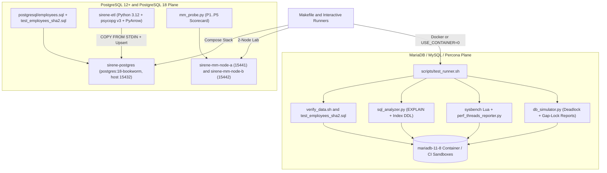
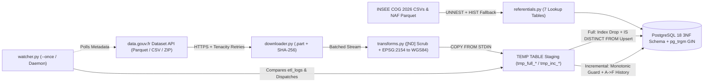

# Platform and ETL Architecture

**test_db** combines a multi-engine relational regression suite (`employees`, `sakila`) with a production-style
**PostgreSQL 18** Third Normal Form (3NF) ETL platform and multi-master qualification lab (`sirene/`).

## 1. Multi-Engine Platform Topology

Rather than locking verification into a single database product, the platform separates **canonical datasets**,
**engine-agnostic checksum contracts**, and **orchestration runners** across two primary runtime planes:

### Design Rationale for Dual-Plane Separation

1. **Cross-Vendor Integrity Parity (`employees/`)**: Both MySQL/MariaDB (`test_employees_sha2.sql`) and PostgreSQL
   (`postgresql/test_employees_sha2.sql`) execute identical row-ordered incremental SHA-256 chains, proving dataset
   equivalence across engines even where DDL syntax diverges (`ENUM` vs `CHAR(1) CHECK`, `delimiter //` vs `$$`).
2. **Workload Isolation via `USE_CONTAINER` & Loopback Ports**: MariaDB tools probe Docker container health before
   deciding between `docker exec` and local socket/TCP execution, whereas Sirene binds PostgreSQL 18 exclusively on
   loopback `127.0.0.1:15432` (and `15441`/`15442` for multi-master) to eliminate collisions with host PostgreSQL
   services on port `5432` (`RCA-003`).
3. **Zero-Python Offline Injection Parity**: Mirroring `employees/` SQL dumps, `sirene/load_sirene.sql` and
   `sirene/test_sirene_sha2.sql` inject and verify a `15,000` legal unit / `30,000` establishment synthetic dataset
   directly inside `psql` without Python dependencies.

---

## 2. Sirene PostgreSQL 18 3NF ETL Pipeline

The `sirene/` subsystem transforms raw `data.gouv.fr` INSEE stock and delta files into a normalized 13-table
relational schema while preserving idempotency, referential integrity across obsolete municipal codes, and
monotonically ordered state history.

### Stage-by-Stage Architectural Responsibilities

- **Stage 1 — Verified Staging (`downloader.py`)**: Streams payloads in `1 MiB` (`1_048_576`-byte) chunks to `.part`
  temporary files under `tenacity` exponential backoff (`stop_after_attempt(4)`), hashing bytes incrementally and
  discarding corrupted streams before atomic target replacement.
- **Stage 2 — Dynamic Referential Protection (`referentials.py`)**: Seeds 7 lookup tables with fallback sentinel keys
  (`UNK`, `UNK00`, `99100`, `00.00Z`, `0000`, `NN`, `UN`). Before merging any entity batch,
  `ensure_missing_referential_codes()` registers previously unseen historical NAF, legal category, municipality, or
  country codes (`nomenclature = 'HIST'`, `type_commune = 'HIST'`), preventing `23503` foreign-key aborts on legacy
  records.
- **Stage 3 — Uniform Multi-Format Transformation (`transforms.py`)**: Streams ZSTD Parquet (`pyarrow.parquet`) and
  `.csv` / `.csv.gz` / `.zip` archives under a unified `BATCH_SIZE` (`50,000` rows), strips trailing header
  whitespace (`RCA-002`), normalizes `[ND]`/`[nd]`/`"null"` sentinels to SQL `NULL`, pads fixed-width codes (`nic`,
  `code_cj`, `code_tranche_effectifs`), and converts Lambert-93 (`EPSG:2154`) coordinates to `WGS84` via pure-Python
  GRS80 fixed-point iteration (`12` iterations, `1e-11` rad tolerance).
- **Stage 4 — Full vs. Incremental Load Paths (`full_import.py`, `incremental_import.py`, `db.py`)**:
  - *Full stock* acquires session advisory lock `84729101`, drops non-constraint secondary indexes
    (`drop_secondary_indexes()`), loads staging temp tables via `psycopg` v3 `COPY FROM STDIN`, creates `'C'`/`'P'`
    placeholders for orphan establishment `siren`s, merges via `IS DISTINCT FROM`, projects sole proprietors into
    `personnes`/`roles_entreprises`, and rebuilds all `25` indexes plus `ANALYZE`.
  - *Incremental delta* commits its read-only lock/checksum check preamble (`conn.commit()`, `RCA-004`), opens a
    single `with conn.transaction():` block with `ON COMMIT DROP` staging tables, deduplicates rows by latest
    `date_dernier_traitement`, audits `'A' <-> 'F'` transitions into `etablissements_historique_etat`, and enforces a
    monotonic timestamp guard so stale deltas never overwrite newer state.
- **Stage 5 — Autonomous Watcher (`watcher.py`)**: Isolates long-running polling behind the Docker Compose `daemon`
  profile (`APP-003`), compares remote `checksum_value`, `last_modified`, `resource_id`, `file_name`, and `title`
  against `etl_logs`, and dispatches full or incremental loads without duplicate ingestion.

## Related Reference & Procedures

- Complete schema, index, and SHA-256 baselines:
  [Datasets & Schemas Matrix](../../03-reference/architecture-specs/datasets-and-schemas-matrix.md)
- CLI scripts and SQL query catalog:
  [CLI Scripts & SQL Catalog](../../03-reference/cli-and-scripts/cli-scripts-and-sql-catalog.md)
- Sirene ETL decision rationale and multi-master verdict:
  [ADR-001: PostgreSQL 18 3NF Sirene ETL & Multi-Master Qualification](../design-decisions/adr-001-postgresql18-3nf-sirene-etl-and-mm-qualification.md)
- Operational Sirene ETL execution guide:
  [Run Sirene Full and Incremental ETL](../../02-how-to-guides/operations/run-sirene-full-and-incremental-etl.md)
