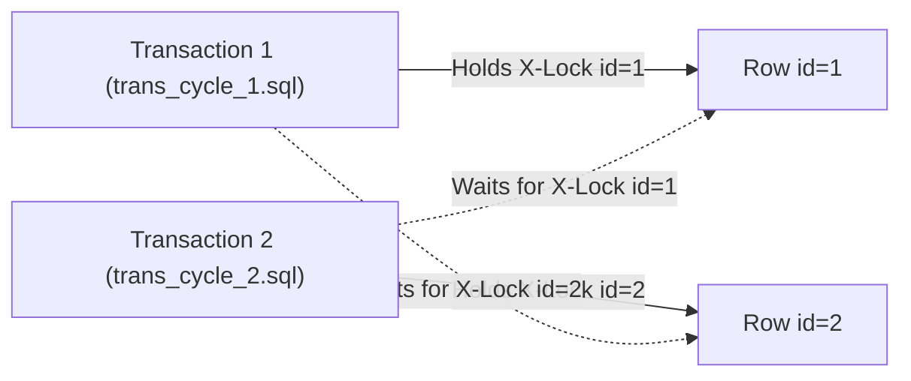
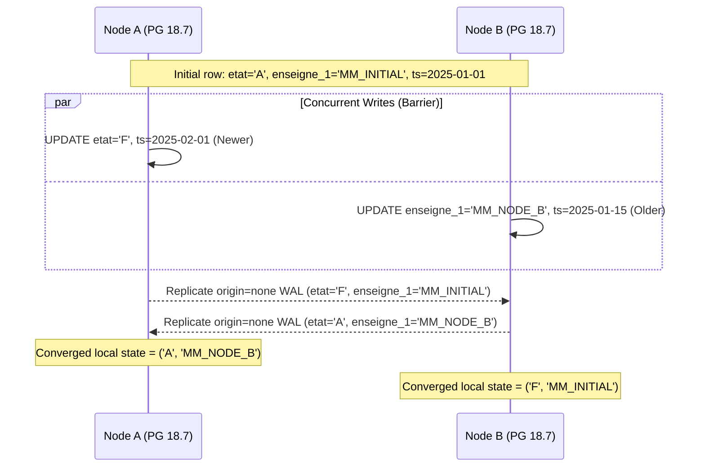

# Concurrency, Locking, and Replication Trade-Offs

This deep dive contrasts pessimistic lock-based concurrency in **MariaDB InnoDB** (`tests/data/deadlock/`,
`tests/data/gap_locking*`), MVCC + advisory locking in **PostgreSQL 18** (`sirene_etl.db`), and asynchronous
conflict causality in **active-active logical replication** (`sirene/mm_probe.py`).

## 1. InnoDB Deadlock Wait-For Graphs (`tests/data/deadlock/`)

InnoDB row-level locks protect individual index records using exclusive (`X`) and shared (`S`) locks. When two
transactions acquire locks on disjoint rows and subsequently request each other's held locks in opposite order, they
form a cycle in InnoDB's internal wait-for graph:

In `tests/data/deadlock/`, `trans_cycle_1.sql` updates `id = 1`, pauses (`SELECT SLEEP(0.2)`), and updates `id = 2`,
while `trans_cycle_2.sql` acquires `id = 2` first and requests `id = 1`. Because neither transaction can progress,
InnoDB detects the cycle immediately rather than waiting for `innodb_lock_wait_timeout`, rolls back the smaller undo
victim (`ER_LOCK_DEADLOCK` `1213` / SQLSTATE `40001`), and logs a `TRANSACTION DEADLOCK` block when
`innodb_print_all_deadlocks = 1` is active (parsed automatically by `scripts/db_simulator.py`).

## 2. Gap Locks and Next-Key Locks Under `REPEATABLE READ` (`tests/data/gap_locking*`)

By default, MariaDB runs at `REPEATABLE READ`. To prevent phantom reads during range scans and locking reads, InnoDB
combines a record lock with a **gap lock** on the open interval between adjacent B-Tree keys (a **next-key lock**).

- **Direct Interval Contention (`tests/data/gap_locking/`)**: Given sparse primary keys `10`, `20`, `30` in `gap_parent`:
  - `trans_A.sql` executes `SELECT * FROM gap_parent WHERE id > 10 AND id < 20 FOR UPDATE`, locking gap `(10, 20)`
    while later inserting `id = 25` into `(20, 30)`.
  - `trans_B.sql` executes `SELECT * FROM gap_parent WHERE id > 20 AND id < 30 FOR UPDATE`, locking gap `(20, 30)`
    while later inserting `id = 15` into `(10, 20)`.
  - Even though neither row `15` nor `25` existed before the queries began, each transaction's gap lock blocks the
    peer's insert intention lock, producing tail-latency spikes (`95th` percentile rising far above mean latency) or
    deadlocks.
- **Unique Index & Foreign-Key Escalation (`tests/data/gap_locking_4/`)**: When a child table (`child_details.p_code`)
  references a unique non-PK column (`parent_metadata.code`), `INSERT INTO child_details ... SELECT ... FROM
  parent_metadata WHERE code > 'C10' AND code < 'C20'` acquires shared (`S`) gap locks on `(C10, C20)` even without
  `FOR UPDATE`. Concurrent `UPDATE`/`DELETE` operations on adjacent unique ranges collide on those gap locks despite
  touching non-overlapping primary keys.

| Isolation Level | InnoDB Gap Locks | Phantom Read Protection | Insert Concurrency | Operational Trade-Off |
| :--- | :--- | :--- | :--- | :--- |
| **`REPEATABLE READ`** (MariaDB default) | Enabled (next-key + gap locks on range scans) | Prevents phantoms in locking reads | Lower under sparse/hot ranges | Protects range consistency at the cost of `1205`/`1213` contention |
| **`READ COMMITTED`** | Disabled for most searches/index scans (kept only for FK & duplicate-key checks) | Permits phantom rows across statements | Higher for concurrent range `INSERT`s | Reduces gap deadlocks; requires application tolerance for non-repeatable reads |

## 3. PostgreSQL MVCC, `AccessShareLock`, and Node-Local Advisory Locks (`sirene_etl.db`)

PostgreSQL replaces rollback-segment undo and InnoDB gap locks with Multi-Version Concurrency Control (MVCC): readers
observe snapshot visibility without blocking writers, and writers never hold gap locks on missing index intervals.
Contention in the Sirene ETL plane arises instead from **DDL lock escalation** and **pipeline serialization**:

1. **DDL vs. Unclosed Read Transactions (`RCA-005`)**: Running `full_import.py` executes `drop_secondary_indexes()`,
   requiring an `AccessExclusiveLock` on `unites_legales`, `etablissements`, `personnes`, and `roles_entreprises`. Any
   client connection left open in `INTRANS` (`autocommit=False`) after a simple `SELECT` holds an `AccessShareLock`,
   queuing behind zero writers yet blocking `DROP INDEX` and all subsequent queries indefinitely.
2. **Transaction Boundaries in `psycopg` v3 (`RCA-004`)**: On `autocommit=False` connections, executing read-only
   preflight checks (`acquire_etl_lock`, `is_checksum_already_imported`) initiates an implicit `BEGIN`. Entering
   `with conn.transaction():` afterward creates a nested `SAVEPOINT` rather than an outer transaction, causing cleanup
   `conn.rollback()` calls to undo committed work silently unless an explicit `conn.commit()` closes the preamble.
3. **Node-Local Advisory Locks (`pg_try_advisory_lock(84729101)`)**: Session-level advisory locks serialize
   `full_import.py`, `incremental_import.py`, and `watcher.py` safely on a single PostgreSQL 18 instance. However,
   `P1_DDL_COMPAT` in `mm_probe.py` proves empirically that advisory locks remain **strictly node-local**: acquiring
   lock `84729199` on Node A succeeds simultaneously on Node B, offering zero cross-cluster mutual exclusion.

## 4. Active-Active Split-Brain Causality in Bidirectional Replication (`mm_probe.py`)

Native PostgreSQL 18 bidirectional logical replication (`CREATE SUBSCRIPTION ... WITH (copy_data = false, origin =
none)`) avoids infinite replication loops by replaying only locally originated WAL records, and staggered `BIGSERIAL`
sequences (`INCREMENT BY 2`, odd vs even) eliminate `P2` primary-key collisions. Yet asynchronous WAL shipping lacks
global consensus ordering and conflict resolution:

### Replication Topology Trade-Offs

| Topology | `P2` Sequence Safety | `P4` Cross-Node FK Causality | `P3` Concurrent Update Convergence | Verdict for Sirene 3NF |
| :--- | :--- | :--- | :--- | :--- |
| **Single-Writer PG 18 + Streaming Replica** | Complete (single primary) | Complete (ordered WAL) | Complete (single writer serialized by row lock) | **Recommended baseline** |
| **Native PG 18 Logical Birep (`origin=none`)** | `PASS` with staggered sequences | `WARN` (async `23503` FK race before sync) | **`FAIL` (`DIVERGED_SPLIT_BRAIN`)** | **`INCOMPATIBLE_WITH_SIRENE_3NF`** |
| **Sharded / Partitioned Active-Active (e.g., Citus)** | Depends on distributed key routing | `PASS` when co-located by `siren` | Avoids overlapping keys via routing | Conditional (`CONDITIONAL_PARTITIONED_WRITES_ONLY`) |
| **LWW / CRDT or Consensus Active-Active (Spock, YugabyteDB, CockroachDB)** | Global / node-partitioned IDs | Transactional / causal barriers | Deterministic LWW or `40001` serialization abort | Production candidate pending `mm_probe.py` `PASS` |

## Related Reference and Procedures

- Failure taxonomy and probe outcomes:
  [Error & Alert Matrix](../../03-reference/troubleshooting-codes/error-and-alert-matrix.md)
- Deadlock, gap-lock, and ETL drift incident runbook:
  [Remediate Deadlocks, Gap Locks, and ETL Drift](../../02-how-to-guides/incident-response/remediate-deadlocks-gap-locks-and-etl-drift.md)
- Multi-master qualification procedure:
  [Qualify PostgreSQL 18 Multi-Master](../../02-how-to-guides/operations/qualify-postgresql18-multimaster.md)
- Sirene 3NF and multi-master ADR:
  [ADR-001: PostgreSQL 18 3NF Sirene ETL & Multi-Master Qualification](../design-decisions/adr-001-postgresql18-3nf-sirene-etl-and-mm-qualification.md)
