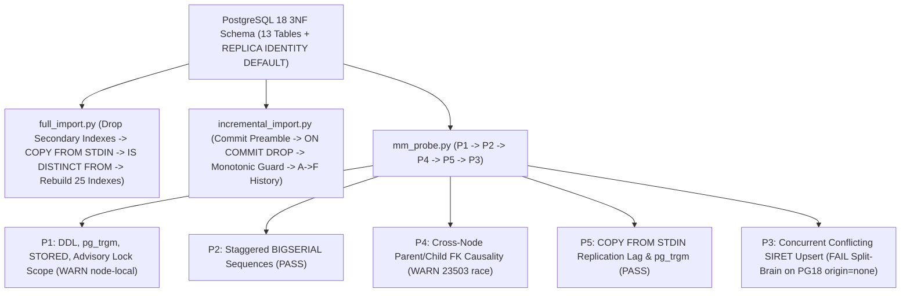

# ADR-001: PostgreSQL 18 3NF Sirene ETL and Multi-Master Qualification

| Attribute | Value |
| :--- | :--- |
| **Status** | Accepted |
| **Date** | `2026-11-20` |
| **Deciders** | `test_db` Architecture, LightPath Data Engineering |
| **Supersedes** | None (`M1`–`M8`, Issues `#4`, `#6`, `#8`, `#10`) |

## Context

Prior to release `1.9.0`, `test_db` focused exclusively on static `employees` and `sakila` dumps. Realistic database
engineering benchmarks and PostgreSQL 18 labs require a normalized, incrementally updatable real-world domain model
that exercises foreign-key hierarchies, trigram text search (`pg_trgm`), spatial conversion, bulk `COPY` throughput,
and multi-master replication conflict semantics.

Four architectural constraints shaped the design:

1. **Historical Referential Drift**: National INSEE Sirene stocks span decades of closed municipalities, deprecated
   NAF codes, and `[ND]` masked diffusion fields that break strict foreign keys unless normalized and guarded.
2. **Bulk Ingestion Throughput vs. Query Latency**: Maintaining `22` secondary B-Tree indexes and `3` `pg_trgm` GIN
   indexes (`idx_ul_nom_trgm`, `idx_etab_enseigne_trgm`, `idx_personnes_nom_trgm`) row-by-row during full-stock loads
   causes severe write amplification.
3. **Incremental Idempotency & Monotonicity**: Re-running or receiving out-of-order delta files must neither lose
   non-null creation dates nor overwrite newer administrative states (`'A'` vs `'F'`).
4. **Active-Active Multi-Master Safety**: Deploying Sirene 3NF across active-active PostgreSQL 18 nodes requires
   empirical proof—not assumption—of DDL compatibility, sequence safety, FK causality, and conflict convergence.

## Architecture and Qualification Flow

## Options Considered and Trade-Offs

| Decision Area | Considered Alternative | Trade-Off Analysis | Selected Choice |
| :--- | :--- | :--- | :--- |
| **Schema Normalization** | Flat single-table Sirene denormalization | Flat tables simplify queries but bloat row width, prevent officer/role portfolios (`personnes` + `roles_entreprises`), and omit `REPLICA IDENTITY` keys for logical replication. | **13-table 3NF schema** on PostgreSQL 18 (`UNIQUE NULLS NOT DISTINCT`, `GENERATED ALWAYS ... STORED`, explicit PKs on every table) |
| **Full-Stock Bulk Load** | Direct `INSERT ... ON CONFLICT` with live indexes | Live GIN and B-Tree maintenance slows large `COPY` batches and fragments GIN pending lists. | **Drop non-constraint secondary indexes**, stream via `COPY FROM STDIN` into `TEMP TABLE`, merge via `IS DISTINCT FROM`, then rebuild + `ANALYZE` |
| **Incremental Delta Sync** | Unconditional `DO UPDATE` without transaction preamble | Unconditional updates corrupt state when deltas replay out of order; `autocommit=False` preambles turn `with conn.transaction():` into a `SAVEPOINT` rolled back on exit (`RCA-004`). | **Explicit `conn.commit()` preamble** + **monotonic `date_dernier_traitement` guard** + `etablissements_historique_etat` transition audit |
| **Active-Active Multi-Master** | Assume PostgreSQL 18 native bidirectional (`origin=none`) + staggered sequences is production-safe | Sequence staggering (`INCREMENT BY 2`) prevents `P2` PK collisions, and `origin=none` prevents infinite loops, yet `origin=none` applies peer updates independently without deterministic LWW or CRDT resolution. | **Disqualify `pg18-native-birep` (`INCOMPATIBLE_WITH_SIRENE_3NF` on `P3`)** and mandate `mm_probe.py` qualification before adopting external MM engines |

## Decision

1. **Adopt PostgreSQL 18 3NF Schema (`sirene/sql/01_schema_3nf.sql`, `02_indexes.sql`)**: Store 7 referential lookup
   tables with idempotent sentinel keys (`UNK`, `UNK00`, `99100`, `00.00Z`, `0000`, `NN`, `UN`), 4 immutable
   `GENERATED ALWAYS AS (...) STORED` search/address columns (using `TRIM`/`COALESCE`/`NULLIF`/`||` because
   `CONCAT_WS` is `STABLE`, not `IMMUTABLE`), `UNIQUE NULLS NOT DISTINCT` on `roles_entreprises`, and 25 secondary/GIN
   indexes (`idx_ul_nom_trgm`, `idx_etab_enseigne_trgm`, `idx_personnes_nom_trgm`).
2. **Adopt `COPY FROM STDIN` Index-Drop/Rebuild & Monotonic Incremental Upserts**: Use `drop_secondary_indexes()`
   preserving constraint-backed PK/UNIQUE indexes during full imports, and enforce the monotonic predicate
   `COALESCE(EXCLUDED.date_dernier_traitement, 'infinity'::timestamptz) >=`
   `COALESCE(target.date_dernier_traitement, '-infinity'::timestamptz)` alongside `IS DISTINCT FROM` and non-null
   `date_creation` preservation during incremental runs.
3. **Qualify Active-Active Candidates via `mm_probe.py` (`P1`–`P5`, `P3` Last)**: Run probes in order
   `P1 -> P2 -> P4 -> P5 -> P3` so any conflict stall in `P3` never blocks `P4`/`P5`. Under empirical testing against
   `PostgreSQL 18.7` (`postgres:18-bookworm`), native bidirectional logical replication (`origin=none`) failed
   `P3_CONCURRENT_SIRET_UPSERT` (`DIVERGED_SPLIT_BRAIN`: Node A held `('A', 'MM_NODE_B')` while Node B held
   `('F', 'MM_INITIAL')`), resulting in verdict `INCOMPATIBLE_WITH_SIRENE_3NF`. Production active-active topologies
   require either single-writer partitioning or an external conflict-resolving engine (`pgEdge Spock`, `YugabyteDB`,
   `CockroachDB`) passing all 5 probes.

## Consequences

### Positive

- **Zero-FK-Failure Ingestion**: Historical COG/NAF codes (`HIST`) and `[ND]` sentinels ingest cleanly without
  relaxing 3NF foreign-key constraints.
- **Deterministic Offline Reproducibility**: Synthetic `15k` UL / `30k` SIRET SQL dumps and Parquet/delta fixtures
  validate both `psql` and Python ETL paths against 12-table SHA-256 baselines (`sirene/test_sirene_sha2.sql`).
- **Pre-Production Split-Brain Detection**: `mm_probe.py` catches silent multi-master divergence (`P3`) and node-local
  advisory lock blind spots (`P1`) before deployment.

### Negative and Operational Risks

- **Full-Import Read Locking**: Dropping secondary indexes requires `AccessExclusiveLock` (`RCA-005`), blocking
  concurrent analytical queries during full-stock index drop/rebuild windows.
- **Native PostgreSQL 18 Multi-Master Restriction**: Native `origin=none` bidirectional replication cannot accept
  overlapping multi-writer updates on `etablissements` or `unites_legales` without silent data divergence.
- **PostgreSQL 18 Volume Layout**: Container deployments require `/var/lib/postgresql` mounts (`RCA-006`) rather than
  legacy `/var/lib/postgresql/data` paths.

## Related Reference and Operational Guides

- Complete 13-table schema, 3 `pg_trgm` GIN indexes, and SHA-256 baseline specification:
  [Datasets & Schemas Matrix](../../03-reference/architecture-specs/datasets-and-schemas-matrix.md)
- Operational procedure for Sirene bulk and incremental ETL execution:
  [Run Sirene Full and Incremental ETL](../../02-how-to-guides/operations/run-sirene-full-and-incremental-etl.md)
- Operational procedure for multi-master qualification with `mm_probe.py`:
  [Qualify PostgreSQL 18 Multi-Master](../../02-how-to-guides/operations/qualify-postgresql18-multimaster.md)
