# ADR-002: Diataxis Documentation Architecture and Versioned MkDocs Publishing

| Attribute | Value |
| :--- | :--- |
| **Status** | Accepted |
| **Date** | `2026-11-23` |
| **Deciders** | `test_db` Maintainers, LightPath Documentation |
| **Supersedes** | None (`Issue #12`) |

## Context

Documentation across `test_db` grew organically into root overviews (`README.md`, `README_fr.md`), module quickstarts
(`sirene/README.md`), bilingual deep-dives (`documentation/en/*.md`, `documentation/fr/*.md`), a self-contained HTML5
reference (`documentation/sirene_documentation.html`), ER notes (`doc_employees/`), `Changelog`, and governance
registers (`docs/ACTION_LOGBOOK.md`, `docs/RCA_REGISTER.md`). Publishing a unified portal at
`https://test-db.lightpath.fr/` on static IONOS Apache hosting surfaced five engineering constraints:

1. **Genre Mixing Across Operational Docs**: Tutorials, production deployment commands, parameter reference tables, and
   architectural trade-offs were interleaved inside long manuals, slowing incident diagnosis and risking untested
   procedural drift.
2. **Heavy Non-Doc Payload (`employees/` ~168 MB)**: Running full-repo `git archive <tag>` across historical release tags
   (`v1.9.0`, `v1.9.1`, `v1.10.0`, `v1.11.0`) copies `~164–168 MB` of raw SQL dump files per version, inflating CI
   build time and temporary disk usage.
3. **Immutable Historical Release Snapshots**: Tags `v1.9.0`..`v1.11.0` predate `mkdocs.yml`, Diataxis quadrant trees
   (`01-tutorials/`..`04-explanation/`), and CSS/KaTeX assets; `v1.9.0` also predates
   `documentation/sirene_documentation.html`.
4. **Legacy Test Compatibility**: Existing governance tests (`sirene/tests/test_documentation_page.py`) mandate preserving
   existing links inside `README.md`, `README_fr.md`, `sirene/README.md`, and `documentation/{en,fr}/index.md`, while
   legacy experiment docs contain `file:///test_db/...` links and Google Docs `?tab=t.0#heading=` anchors.
5. **Static Hosting, Routing & Secret Hygiene**: IONOS shared hosting supports static files plus Apache `.htaccess`
   redirects (`/` -> `/<latest>/`, `/latest/`, `/dev/`, `/main/` -> `/master/`) and requires `mike`-compatible
   `versions.json`, `exclude_docs` filtering, and strict exclusion of `.kdbx`, `.keyx`, `.pid`, `.log`, and `.env*`
   artifacts.

## Multi-Version Build and Publishing Pipeline

```mermaid
flowchart LR
    GIT["Git Tags (v1.9.0..v1.11.0) + master / WORKTREE"] --> TREE["git ls-tree + Sparse git archive (Excludes 168 MB employees/)"]
    TREE --> OVERLAY["Overlay mkdocs.yml, mkdocs_hooks.py, CSS/JS, Fallback Assets"]
    OVERLAY --> HOOKS["scripts/mkdocs_hooks.py (Virtual Docs, file:///test_db/ Rewrite, v1.9.0 Fallback)"]
    HOOKS --> MK["mkdocs build --strict (6-Tab Material Nav + KaTeX + Mermaid)"]
    MK --> GUARD["Privacy Guard (Block .kdbx, .keyx, .pid, .log, .env*)"]
    GUARD --> DIST["site_dist/ (versions.json, .htaccess, /master/, /v*/)"]
    DIST --> SFTP["SHA-Pinned GitHub Actions SFTP -> https://test-db.lightpath.fr/"]
```

## Options Considered and Trade-Offs

| Option | Genre Isolation & STE Compliance | Historical Tag Build Speed | Static IONOS Hosting & Legacy Parity | Verdict |
| :--- | :--- | :--- | :--- | :--- |
| **Option A: Flat `documentation/{en,fr}/` Only** | Low: mixes labs, procedures, schemas, and architecture in single files | N/A | No unified search, `mike` version selector, or `.htaccess` version routing | Rejected |
| **Option B: Unversioned MkDocs via Full Repo Checkout** | Medium: adds site nav, but copies 168 MB `employees/` dumps on every build | Poor: full `git archive` per tag multiplies 168 MB I/O across tags | Single `master` snapshot only; historical `v1.9.x` users lack matching docs | Rejected |
| **Option C: Diataxis 4-Quadrant Tree + Sparse Overlay MkDocs Material** | **High**: isolates `01-tutorials/`, `02-how-to-guides/` (ASD-STE100 Issue 9), `03-reference/`, and `04-explanation/` while keeping bilingual guides in `nav:` | **Fast**: `git ls-tree` + sparse `git archive` extracts only doc paths (`README*`, `docs/`, `documentation/`, `doc_employees/`, `Changelog`, `sirene/README.md`) | **Full**: generates `site_dist/` with `versions.json`, `.htaccess` (`301`/`302` rules for `master`, `latest`, `dev`, `main`), virtual docs, and `sirene/tests/test_documentation_page.py` parity | **Selected** |

## Decision

Adopt **Option C**:

1. **Strict 4-Quadrant Diataxis Architecture**: Separate repository technical documentation into `docs/01-tutorials/`,
   `docs/02-how-to-guides/` (with `.vale.ini` `MinAlertLevel = error` and ASD-STE100 Issue 9 `<= 20` words/sentence),
   `docs/03-reference/`, and `docs/04-explanation/`, rooted at `docs/index.md` and mapped into a 6-tab MkDocs
   Material navigation (`Home`, `Tutorials`, `How-To Guides`, `Reference`, `Explanation`, `Releases & Governance`).
2. **Sparse Historical `git archive` Overlay (`scripts/build_versioned_docs.py`)**: Inspect `git ls-tree -r --name-only <tag>`
   for each tag `>= v1.9.0` and invoke sparse `git archive` solely on documentation paths, excluding the `~168 MB`
   `employees/` dump payload. Build `/master/` (aliased as `dev`) alongside semantic tags (newest aliased as `latest`),
   emitting `versions.json`, HTML redirect pages, and Apache `.htaccess` rules.
3. **Virtual Docs Injection & Legacy Link Normalization (`scripts/mkdocs_hooks.py`)**: Keep zero optional imports at
   module top so unit tests run cleanly without MkDocs; inject `overview-en.md` (`README.md`), `overview-fr.md`
   (`README_fr.md`), `CHANGELOG.md` (`Changelog`), `sirene-quickstart.md` (`sirene/README.md`), `guides/{en,fr}/*.md`,
   `guides/employees-sql-{en,fr}.md`, and static asset `guides/sirene_documentation.html`. Rewrite `file:///test_db/`
   links to pinned GitHub blob/tree URLs, clean legacy `#heading=` fragments, neutralize excluded secret targets, and
   resolve `v1.9.0` historical fallbacks (`sirene_documentation.html -> sirene-quickstart.md`) cleanly under
   `mkdocs build --strict`.
4. **Supply-Chain Hardened CI/CD & Privacy Guard**: Pin all GitHub Actions in `.github/workflows/docs-ci.yml` and
   `docs-publish.yml` to 40-character commit SHAs, pass dynamic context via `env:` (never `${{ ... }}` inside `run:`),
   publish to IONOS SFTP (`IONOS_REMOTE_PATH`) followed by explicit `.htaccess` upload, and verify live HTTPS routes
   (`versions.json`, `latest/`, `master/`).

## Consequences

### Positive

- **Fast Multi-Version Builds**: Sparse `git archive` eliminates redundant extraction of `168 MB` SQL dump files per
  historical tag.
- **Zero-Regression Legacy Compatibility**: Existing links in `README.md`, `README_fr.md`, and `documentation/` stay
  100% functional on GitHub while rendering seamlessly inside the MkDocs Material portal.
- **Automated Quality & Privacy Gates**: `diataxis_check.py --strict --check-ste`, `pytest`, `.vale.ini`,
  `.markdownlint.json`, `exclude_docs`, and post-build privacy checks enforce structural, linguistic, and secret
  boundaries prior to SFTP deployment.

### Negative and Operational Risks

- **Tag-Snapshot Fallback Coupling**: Introducing new top-level links in overlaid `docs/index.md` or `mkdocs.yml`
  requires verifying `on_config` nav pruning and historical fallback mapping against `v1.9.0`..`v1.11.0`.
- **Dual Link Validation Surface**: Relative links inside `docs/` must simultaneously resolve on disk for
  `diataxis_check.py` / `pytest` and rewrite accurately in `scripts/mkdocs_hooks.py`.

## Related Reference and Security Guides

- Full `Makefile` `docs-*` targets, `TEST_DB_DOCS_*` variables, and CI secrets:
  [Environment Variables & Makefile Targets](../../03-reference/configuration/environment-variables-and-makefile-targets.md)
- Checksum, `exclude_docs`, and privacy boundary verification procedure:
  [Verify Checksums and Privacy Boundaries](../../02-how-to-guides/security/verify-checksums-and-privacy-boundaries.md)
- Stack deployment SOP:
  [Deploy MariaDB and PostgreSQL Stacks](../../02-how-to-guides/deployment/deploy-mariadb-and-postgresql-stacks.md)
