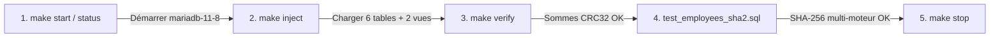

# Tutoriel 1 : Bac à sable MariaDB 11.8 Employees

> **Objectif pédagogique :** Démarrer le conteneur Docker isolé `mariadb-11-8`, injecter le jeu canonique
> `employees` (`300 024` employés et `2 844 047` salaires) et vérifier les sommes CRC32 (`make verify`) et SHA-256
> (`test_employees_sha2.sql`).

> [!WARNING]
> **Conteneur de laboratoire local uniquement :** La configuration par défaut utilise `DB_USER="root"` avec un mot de
> passe vide (`DB_PASS=""`). N'utilisez jamais ces paramètres sur un serveur partagé ou de production.

---

## Prérequis

Vérifiez que votre poste dispose des éléments suivants avant de démarrer :

- Moteur Docker actif avec un conteneur provisionné nommé `mariadb-11-8` (incluant le client `mariadb` et `sysbench`)
- `make`, `bash` et les utilitaires Unix standards dans votre `PATH`
- Dépôt `test_db` cloné à la racine (`Makefile` et `employees/` présents)

Vérifiez la présence du conteneur `mariadb-11-8` sur votre hôte Docker :

```bash
docker ps -a --filter name=mariadb-11-8 --format "table {{.Names}}\t{{.Status}}"
```

Sortie attendue :

```text
NAMES          STATUS
mariadb-11-8   Exited (0) ...
```

---

## Ce que vous allez construire



À la fin de ce tutoriel, vous aurez :

1. Démarré le conteneur `mariadb-11-8` et vérifié son état avec `make status`.
2. Chargé le schéma `employees` à 6 tables, 2 vues et les fichiers `.dump` via `make inject`.
3. Validé le nombre de lignes et les sommes CRC32 avec `make verify`.
4. Exécuté le contrôle déterministe SHA-256 avec `test_employees_sha2.sql`.
5. Arrêté proprement le bac à sable avec `make stop`.

---

## Étape 1 : Démarrer et inspecter le conteneur MariaDB

Démarrez `mariadb-11-8` depuis la racine du dépôt et vérifiez son statut :

```bash
make start
make status
```

Sortie attendue :

```text
🚀 Starting MariaDB container (mariadb-11-8)...
mariadb-11-8
📊 Status of MariaDB container (mariadb-11-8):
CONTAINER ID   IMAGE          COMMAND                  CREATED         STATUS         PORTS                    NAMES
...            mariadb:11.8   "docker-entrypoint.s…"   ...             Up 2 seconds   0.0.0.0:3306->3306/tcp   mariadb-11-8
```

---

## Étape 2 : Injecter le jeu de données canonique `employees`

Copiez les scripts SQL et les fichiers `.dump` depuis `employees/` vers `/tmp/employees_data/` dans le conteneur et
lancez `make inject` :

```bash
make inject
```

Sortie attendue :

```text
💉 Injecting employees.sql into mariadb-11-8...
INFO
CREATING DATABASE STRUCTURE
INFO
storage engine: InnoDB
INFO
LOADING departments
INFO
LOADING employees
...
```

Le script `employees/employees.sql` recrée proprement la base `employees` afin que chaque ré-exécution reparte d'un
état identique.

---

## Étape 3 : Vérifier les comptages et les sommes CRC32

Exécutez `make verify` pour comparer les comptages et les sorties `CHECKSUM TABLE` avec la référence de
`scripts/verify_data.sh` :

```bash
make verify
```

Sortie attendue :

```text
ℹ️ Using Docker container: mariadb-11-8
ℹ️ Verifying data in container: mariadb-11-8
Table                     Count          Checksum       Status
------------------------- ----------     --------------- ----------
departments                        9          3407387832 OK
dept_emp                      331603          3190576018 OK
dept_manager                      24          3048905531 OK
employees                     300024           610052939 OK
salaries                     2844047          4273816835 OK
titles                        443308          1842528371 OK
----------------------------------------------------------
✅ Data integrity verification passed!
```

---

## Étape 4 : Exécuter la vérification SHA-256 multi-moteurs

Lancez `test_employees_sha2.sql` dans le conteneur pour contrôler les sommes déterministes `SHA2(..., 256)` :

```bash
docker exec -i mariadb-11-8 mariadb -u root -t < test_employees_sha2.sql
```

Sortie attendue (résumé final) :

```mysql
+--------------+---------------+------------------------------------------------------------------+
| table_name   | records_match | crc_match                                                        |
+--------------+---------------+------------------------------------------------------------------+
| departments  | OK            | ok                                                               |
| dept_emp     | OK            | ok                                                               |
| dept_manager | OK            | ok                                                               |
| employees    | OK            | ok                                                               |
| salaries     | OK            | ok                                                               |
| titles       | OK            | ok                                                               |
+--------------+---------------+------------------------------------------------------------------+
+---------+--------+
| summary | result |
+---------+--------+
| CRC     | OK     |
| count   | OK     |
+---------+--------+
```

---

## Étape 5 : Arrêter le conteneur de test

Arrêtez proprement le conteneur MariaDB à la fin du laboratoire :

```bash
make stop
```

---

## Étapes suivantes

- Continuer vers le [Tutoriel 2 : Lab Sirene PostgreSQL 18 hors ligne](02-lab-sirene-postgresql18-hors-ligne.md)
- Consulter les procédures de déploiement :
  [Guides pratiques](../02-guides-pratiques/index.md) et
  [Déployer les piles MariaDB et PostgreSQL](../02-guides-pratiques/deploiement/deployer-piles-mariadb-et-postgresql.md)
- Consulter les tables, comptages et empreintes SHA-256 :
  [Matrice des jeux de données et schémas](../03-reference/architecture-specs/matrice-jeux-donnees-et-schemas.md) et
  [Référence](../03-reference/index.md)
- Explorer l'architecture multi-moteurs :
  [Architecture plateforme et ETL](../04-explications/vue-architecture/architecture-plateforme-et-etl.md) et
  [Explications](../04-explications/index.md)
