# Tutoriel 2 : Lab Sirene PostgreSQL 18 3NF hors ligne

> **Objectif pédagogique :** Démarrer un conteneur PostgreSQL 18 isolé (`sirene-postgres`), injecter le jeu INSEE
> Sirene synthétique sans PII (`15 000` unités légales et `30 000` établissements) via `psql`, vérifier les sommes
> SHA-256 sur 12 tables et exécuter les pipelines ETL Parquet complets et incrémentaux hors ligne.

> [!WARNING]
> **Laboratoire Docker local uniquement :** `sirene/docker-compose.yml` écoute sur `127.0.0.1:15432` avec le mot de
> passe de lab éphémère `pg_sirene_ephemeral` et charge des identifiants SIREN factices `9xxxxxxxx`. N'exposez jamais
> ces identifiants sur un réseau partagé.

---

## Prérequis

Vérifiez que votre poste dispose des éléments suivants :

- Docker Engine `24+` avec Docker Compose v2 (`docker compose`)
- GNU `make` et le dépôt `test_db` cloné (`sirene/` présent)
- Port TCP local `15432` libre sur `127.0.0.1`

Validez que Docker Compose interprète correctement la pile Sirene :

```bash
docker compose -f sirene/docker-compose.yml config --services
```

Sortie attendue :

```text
sirene-postgres
sirene-etl
```

---

## Ce que vous allez construire

```mermaid
flowchart LR
    UP["1. make sirene-up"] -->|"PostgreSQL 18 sur 127.0.0.1:15432"| INJ["2. make sirene-inject"]
    INJ -->|"SQL 15k UL + 30k SIRET"| VER["3. make sirene-verify"]
    VER -->|"12/12 SHA-256 OK"| IMP["4. make sirene-import-sample"]
    IMP -->|"COPY Parquet hors ligne"| INC["5. make sirene-incremental-sample"]
    INC -->|"Historique A->F + etl_logs"| DOWN["6. make sirene-down"]
```



À la fin de ce tutoriel, vous aurez :

1. Démarré PostgreSQL 18 (`postgres:18-bookworm`) avec stockage persistant `/var/lib/postgresql` (`make sirene-up`).
2. Chargé le schéma 3NF à 13 tables et les dumps SQL synthétiques sans dépendance Python (`make sirene-inject`).
3. Vérifié les 12 tables peuplées face aux sommes SHA-256 déterministes (`make sirene-verify`).
4. Exécuté l'importateur Parquet Python (`make sirene-import-sample`) et le pipeline delta incrémental
   (`make sirene-incremental-sample`).
5. Inspecté `etablissements_historique_etat` et `etl_logs`, puis arrêté la pile Compose (`make sirene-down`).

---

## Étape 1 : Démarrer le conteneur PostgreSQL 18 Sirene

Démarrez `sirene-postgres` en mode détaché et contrôlez l'état de santé :

```bash
make sirene-up
docker compose -f sirene/docker-compose.yml ps
```

Sortie attendue :

```text
🐘 Starting Sirene PostgreSQL 18 container...
...
NAME                      IMAGE                  STATUS                   PORTS
sirene-sirene-postgres-1  postgres:18-bookworm   Up ... (healthy)         127.0.0.1:15432->5432/tcp
```

---

## Étape 2 : Injecter les dumps SQL 3NF synthétiques

Exécutez `make sirene-inject` pour jouer `sirene/load_sirene.sql` dans `sirene-postgres` via `psql` :

```bash
make sirene-inject
```

Sortie attendue :

```text
💉 Injecting synthetic Sirene SQL dumps into sirene-postgres...
              status
-----------------------------------
 CREATING SIRENE 3NF SCHEMA
...
 SIRENE DATABASE LOAD COMPLETE
```

---

## Étape 3 : Vérifier les comptages et sommes SHA-256

Exécutez `make sirene-verify` pour lancer `sirene/test_sirene_sha2.sql` sur les 7 référentiels et 5 tables métier :

```bash
make sirene-verify
```

Sortie attendue (extrait final) :

```psql
           table_name           | records_match | crc_match
--------------------------------+---------------+-----------
 etablissements                 | OK            | OK
 etablissements_historique_etat | OK            | OK
 personnes                      | OK            | OK
 ref_categories_juridiques      | OK            | OK
 ref_communes                   | OK            | OK
 ref_departements               | OK            | OK
 ref_naf                        | OK            | OK
 ref_pays                       | OK            | OK
 ref_regions                    | OK            | OK
 ref_tranches_effectifs         | OK            | OK
 roles_entreprises              | OK            | OK
 unites_legales                 | OK            | OK
(12 rows)

 summary | result
---------+--------
 CRC     | OK
 count   | OK
(2 rows)
```

---

## Étape 4 : Exécuter l'importateur Parquet hors ligne

Testez maintenant le pipeline Python 3.12 (`sirene/full_import.py`) dans `sirene-etl` sur les fichiers Parquet ZSTD
embarqués dans `sirene/data/parquet/` (`--offline-refs --force`) :

```bash
make sirene-import-sample
```

Sortie attendue (événements JSON structurés clés) :

```text
📥 Running full_import.py against embedded offline synthetic Parquet files...
... "event": "indexes_dropped" ...
... "event": "full_import_completed", "stats": {"ul_processed": 15000, ..., "etab_processed": 30000, ...} ...
```

---

## Étape 5 : Appliquer le pipeline delta incrémental hors ligne

Lancez `make sirene-incremental-sample` sur `DeltaUniteLegale_synthetic.parquet` (`250` lignes) et
`DeltaEtablissement_synthetic.parquet` (`500` lignes) :

```bash
make sirene-incremental-sample
```

Inspectez les transitions administratives `'A' -> 'F'` enregistrées et le journal `etl_logs` :

```bash
docker compose -f sirene/docker-compose.yml exec -T sirene-postgres \
  psql -U sirene -d sirene -c "SELECT COUNT(*) AS history_rows FROM etablissements_historique_etat;"
docker compose -f sirene/docker-compose.yml exec -T sirene-postgres \
  psql -U sirene -d sirene -c "SELECT run_type, entity_type, status, rows_processed FROM etl_logs ORDER BY id;"
```

---

## Étape 6 : Arrêter la pile Docker Compose Sirene

Arrêtez les conteneurs Sirene en fin de laboratoire :

```bash
make sirene-down
```

---

## Étapes suivantes

- Continuer vers le [Tutoriel 3 : Lab Concurrence et Benchmarks](03-lab-concurrence-et-benchmarks.md)
- Exécuter les procédures d'ETL en exploitation :
  [Guides pratiques](../02-guides-pratiques/index.md) et
  [Exécuter l'ETL Sirene complet et incrémental](../02-guides-pratiques/exploitation/executer-etl-sirene-complet-et-incremental.md)
- Consulter le schéma 3NF à 13 tables et les index GIN :
  [Matrice des jeux de données et schémas](../03-reference/architecture-specs/matrice-jeux-donnees-et-schemas.md) et
  [Référence](../03-reference/index.md)
- Comprendre les choix de `COPY` et d'upsert monotone :
  [ADR-001 : ETL Sirene PostgreSQL 18 3NF et qualification MM](../04-explications/decisions-architecture/adr-001-postgresql18-3nf-sirene-etl-et-qualification-mm.md) et
  [Explications](../04-explications/index.md)
