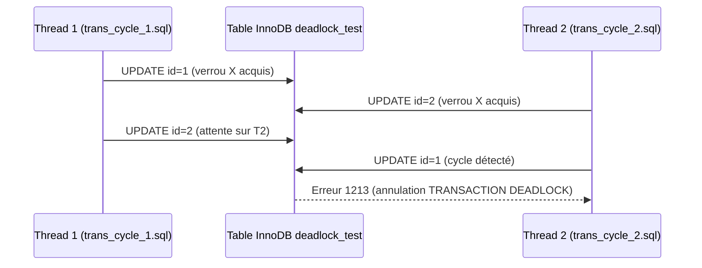

# Tutoriel 3 : Lab Concurrence et Benchmarks

> **Objectif pédagogique :** Mesurer le débit SQL avec `make bench`, simuler des deadlocks InnoDB
> (`make test-data TEST=deadlock`) et des blocages de gap locking (`make test-data TEST=gap_locking`), générer des
> recommandations d'index `EXPLAIN` (`make analyze`) et nettoyer les rapports (`make clean`).

> [!WARNING]
> **Conteneur de laboratoire isolé uniquement :** Les tests de contention créent des cycles de verrous intentionnels,
> des délais `SLEEP()` et des tables temporaires (`deadlock_test`, `gap_parent`, `gap_child`). Exécutez ces exercices
> uniquement sur le bac à sable `mariadb-11-8`.

---

## Prérequis

Vérifiez que votre environnement est prêt :

- Conteneur `mariadb-11-8` démarré et chargé avec `employees` (suivez d'abord le
  [Tutoriel 1 : Bac à sable MariaDB 11.8 Employees](01-bac-a-sable-mariadb-employees.md), ou exécutez
  `make start && make inject`)
- Python 3 disponible dans `PATH` pour `scripts/db_simulator.py` et `scripts/sql_analyzer.py`
- `sysbench` installé dans le conteneur `mariadb-11-8`

Confirmez que `mariadb-11-8` fonctionne :

```bash
make status
```

---

## Ce que vous allez construire


À la fin de ce tutoriel, vous aurez :

1. Exécuté la boucle Lua Sysbench à 60 requêtes (`10` itérations = `600` événements) via `make bench`.
2. Simulé un deadlock circulaire InnoDB sur 4 threads (`make test-data TEST=deadlock`) et consulté `reports/deadlock/`.
3. Observé les attentes sur verrous d'intervalle `REPEATABLE READ` (`make test-data TEST=gap_locking`).
4. Produit les fichiers `EXPLAIN` et `reports/performance_report.html` via `make analyze`.
5. Nettoyé les artefacts générés avec `make clean`.

---

## Étape 1 : Exécuter le benchmark Sysbench

Lancez `make bench` depuis la racine du dépôt. `scripts/test_runner.sh` copie `scripts/employees_sysbench.lua` et
`employees/req_employees.sql` (`60` requêtes) dans le conteneur pour exécuter `600` événements séquentiels sur `1`
thread :

```bash
make bench
```

---

## Étape 2 : Simuler des deadlocks circulaires InnoDB



Exécutez la suite `deadlock` depuis `tests/data/deadlock/` :

```bash
make test-data TEST=deadlock
```

Sortie attendue (extrait de progression) :

```text
ℹ️ Using Docker container: mariadb-11-8
=== Subdirectory Data Tests ===
📂 Running test: deadlock...
🚀 Starting simulation on 127.0.0.1...
   ├─ Nature:   deadlock
   ├─ Threads:  4
   ├─ Duration: 10s
   └─ Target:   employees
🔧 Running setup script: tests/data/deadlock/setup.sql
...
🧹 Running teardown script: tests/data/deadlock/teardown.sql
✅ Finished deadlock. Reports in reports/deadlock/
```

Consultez ensuite `reports/deadlock/report_deadlock.md` et `reports/deadlock/report_deadlock.html`.

---

## Étape 3 : Simuler la contention par gap locking InnoDB

Lancez la suite `gap_locking` pour observer comment `SELECT ... WHERE id > 10 AND id < 20 FOR UPDATE` bloque les
insertions concurrentes entre `10` et `20` :

```bash
make test-data TEST=gap_locking
```

Comparez `avg` et `95th percentile` dans `reports/gap_locking/report_gap_locking.md` pour mesurer les pics d'attente
causés par le mode `REPEATABLE READ`.

---

## Étape 4 : Exécuter l'analyse de performance `EXPLAIN`

Lancez `make analyze` pour évaluer les `60` requêtes de `employees/req_employees.sql` via `scripts/sql_analyzer.py` :

```bash
make analyze
```

Inspectez les rapports dans `reports/performance_report.md`, `reports/performance_report.html` et
`reports/explain_reports/`.

---

## Étape 5 : Nettoyer les rapports générés

Supprimez les rapports générés et arrêtez MariaDB en fin de séance :

```bash
make clean
make stop
```

---

## Étapes suivantes

- Exécuter des campagnes multi-threads et OLTP personnalisées :
  [Guides pratiques](../02-guides-pratiques/index.md) et
  [Exécuter Sysbench et l'analyse SQL](../02-guides-pratiques/exploitation/executer-sysbench-et-analyse-sql.md)
- Consulter les options de `db_simulator.py`, `sql_analyzer.py` et le catalogue SQL :
  [Catalogue des scripts CLI et SQL](../03-reference/cli-et-scripts/catalogue-scripts-cli-et-sql.md) et
  [Référence](../03-reference/index.md)
- Étudier les graphes d'attente InnoDB, gap locks et verrous PostgreSQL :
  [Compromis concurrence, verrouillage et réplication](../04-explications/analyses-internes/compromis-concurrence-verrous-et-replication.md) et
  [Explications](../04-explications/index.md)
