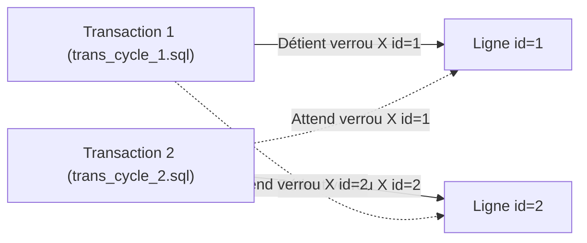
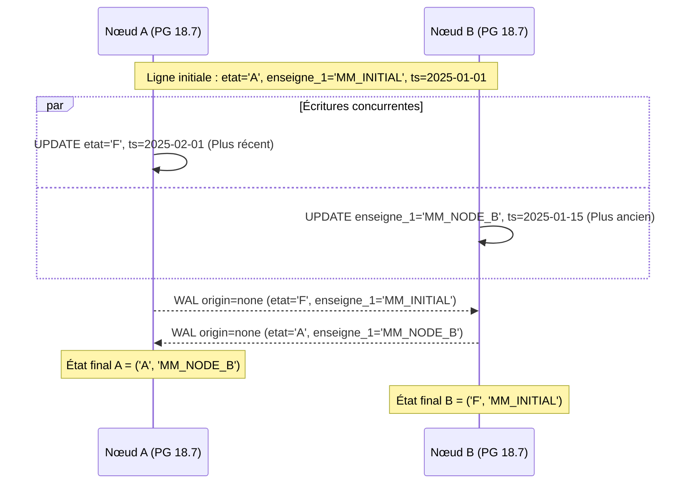

# Compromis de concurrence, verrouillage et réplication

Cette analyse compare le verrouillage pessimiste de **MariaDB InnoDB** (`tests/data/deadlock/`,
`tests/data/gap_locking*`), le MVCC + verrous consultatifs de **PostgreSQL 18** (`sirene_etl.db`) et la causalité
asynchrone en **réplication logique bidirectionnelle** (`sirene/mm_probe.py`).

## 1. Graphes d'attente et deadlocks InnoDB (`tests/data/deadlock/`)

Lorsque deux transactions acquièrent des verrous exclusifs (`X`) sur des lignes distinctes puis demandent le verrou
détenu par l'autre en ordre inverse, un cycle se forme dans le graphe d'attente InnoDB :

InnoDB détecte immédiatement ce cycle, annule la transaction victime la plus légère (`ER_LOCK_DEADLOCK` `1213`) et
journalise le bloc `TRANSACTION DEADLOCK` lorsque `innodb_print_all_deadlocks = 1` est activé.

## 2. Verrous d'intervalle (Gap Locks) sous `REPEATABLE READ`

Sous `REPEATABLE READ` (mode par défaut de MariaDB), InnoDB combine un verrou d'enregistrement et un **gap lock** sur
l'intervalle ouvert entre clés adjacentes pour empêcher les lectures fantômes.

| Niveau d'isolation | Gap locks InnoDB | Protection fantômes | Concurrence en insertion | Compromis opérationnel |
| :--- | :--- | :--- | :--- | :--- |
| **`REPEATABLE READ`** (défaut) | Actifs sur balayages d'intervalles | Empêche les fantômes en lecture verrouillée | Réduite sur plages creuses/chaudes | Protège la cohérence d'intervalle au prix d'attentes `1205`/`1213` |
| **`READ COMMITTED`** | Désactivés hors FK / doublons | Autorise les lignes fantômes entre requêtes | Plus élevée pour `INSERT` concurrents | Réduit les deadlocks d'intervalle mais demande tolérance applicative |

## 3. Divergence split-brain en réplication logique bidirectionnelle (`mm_probe.py`)

Sous PostgreSQL 18 natif (`origin=none`), les séquences `BIGSERIAL` décalées évitent les collisions de clés `P2`, mais
l'application asynchrone des journaux WAL sans horloge logique LWW ni arbitrage CRDT produit une divergence silencieuse
dès que deux nœuds mettent à jour le même `siret` simultanément :

## Références et procédures associées

- [Matrice des erreurs et alertes](../../03-reference/codes-erreurs/matrice-erreurs-et-alertes.md)
- [Remédier aux deadlocks, gap locks et dérives ETL](../../02-guides-pratiques/gestion-incidents/remedier-deadlocks-gap-locks-et-derive-etl.md)
- [Qualifier PostgreSQL 18 multi-maître](../../02-guides-pratiques/exploitation/qualifier-postgresql18-multimaitre.md)
- [ADR-001 : ETL Sirene PostgreSQL 18 3NF et qualification MM](../decisions-architecture/adr-001-postgresql18-3nf-sirene-etl-et-qualification-mm.md)
