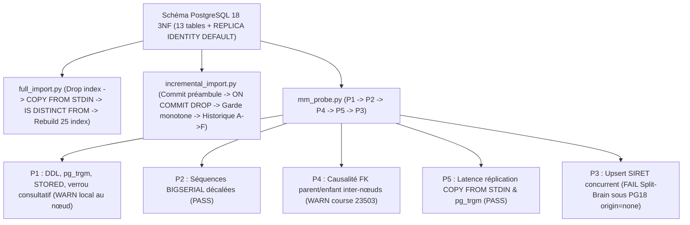

# ADR-001 : ETL Sirene PostgreSQL 18 3NF et qualification multi-maître

| Attribut | Valeur |
| :--- | :--- |
| **Statut** | Accepté |
| **Date** | `2026-11-20` |
| **Décideurs** | Architecture `test_db`, Ingénierie des données LightPath |
| **Remplace** | Aucun (`M1`–`M8`, Issues `#4`, `#6`, `#8`, `#10`) |

## Contexte

Avant la version `1.9.0`, `test_db` se limitait aux jeux statiques `employees` et `sakila`. La modélisation réaliste sur
PostgreSQL 18 nécessitait un modèle normalisé, incrémental, compatible avec la recherche trigramme (`pg_trgm`), le débit
`COPY` et la qualification empirique de la réplication bidirectionnelle.

## Flux d'architecture et de qualification

## Compromis et décision

| Axe de décision | Alternative écartée | Choix retenu |
| :--- | :--- | :--- |
| **Normalisation** | Table unique dénormalisée | **Schéma 3NF à 13 tables** (`UNIQUE NULLS NOT DISTINCT`, colonnes `STORED` immuables, PK explicite partout) |
| **Chargement complet** | `INSERT ... ON CONFLICT` avec index actifs | **Suppression des index secondaires** + `COPY FROM STDIN` + fusion `IS DISTINCT FROM` + reconstruction |
| **Synchronisation delta** | `DO UPDATE` inconditionnel | **Préambule `conn.commit()`** + garde monotone `date_dernier_traitement` + historique `'A' -> 'F'` |
| **Multi-maître actif-actif** | Supposer `origin=none` natif PG 18 sûr | **Disqualification de `pg18-native-birep` (`INCOMPATIBLE_WITH_SIRENE_3NF` sur `P3`)** et qualification obligatoire via `mm_probe.py` |

## Conséquences

- **Ingestions sans échec de clé étrangère** : les codes obsolètes `HIST` et sentinelles `[ND]` sont gérés en 3NF.
- **Reproductibilité hors ligne** : `15k` UL / `30k` SIRET vérifiés par SHA-256 (`sirene/test_sirene_sha2.sql`).
- **Détection précoce du split-brain** : `mm_probe.py` empêche la mise en production d'une topologie active-active sans arbitrage de conflit.

## Références et guides opérationnels associés

- [Matrice des jeux de données et schémas](../../03-reference/architecture-specs/matrice-jeux-donnees-et-schemas.md)
- [Exécuter l'ETL Sirene complet et incrémental](../../02-guides-pratiques/exploitation/executer-etl-sirene-complet-et-incremental.md)
- [Qualifier PostgreSQL 18 multi-maître](../../02-guides-pratiques/exploitation/qualifier-postgresql18-multimaitre.md)
