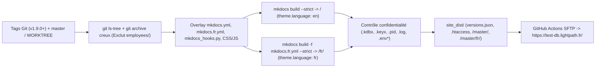

# ADR-002 : Architecture Diátaxis et publication MkDocs versionnée EN/FR

| Attribut | Valeur |
| :--- | :--- |
| **Statut** | Accepté |
| **Date** | `2026-11-24` |
| **Décideurs** | Mainteneurs `test_db`, Documentation LightPath |
| **Remplace** | Complète ADR-002 initial (`Issue #12`) |

## Contexte

La documentation initiale mêlait pages anglaises et françaises dans un seul fichier `mkdocs.yml`, sans quadrant
Diátaxis français ni sélecteur de langue `extra.alternate`. De plus, la génération des archives historiques (`v1.9.0+`)
doit exclure les `168 Mio` de dumps `employees/` tout en servant simultanément les portails `/<ver>/` (EN) et
`/<ver>/fr/` (FR) sur l'hébergement Apache IONOS.

## Pipeline de compilation et publication bilingue séparée

## Compromis et décision

| Option | Séparation linguistique & Diátaxis | Publication multi-versions | Décision |
| :--- | :--- | :--- | :--- |
| **Site unique mixte EN/FR** | Mélange les résultats de recherche et menus | Un seul arbre | Rejetée |
| **Deux configs dédiées (`mkdocs.yml` + `mkdocs.fr.yml`)** | **100 % isolé** : `docs/` (EN, STE) vs `docs/fr/` (FR, STF) avec sélecteur `extra.alternate` dynamique | Construit `<ver>/` et `<ver>/fr/` via `build_versioned_docs.py` | **Retenue** |

## Conséquences

- **Isolation linguistique stricte** : l'index de recherche, l'interface Material et les balises `<html lang="...">` restent homogènes dans chaque langue.
- **Zéro duplication d'actifs** : `scripts/mkdocs_hooks.py` monte virtuellement les feuilles CSS, KaTeX, SVG et registres de gouvernance dans la compilation française.

## Références et sécurité associées

- [Variables d'environnement et cibles Makefile](../../03-reference/configuration/variables-environnement-et-cibles-makefile.md)
- [Vérifier les sommes de contrôle et la confidentialité](../../02-guides-pratiques/securite/verifier-sommes-controle-et-confidentialite.md)
- [Déployer les piles MariaDB et PostgreSQL](../../02-guides-pratiques/deploiement/deployer-piles-mariadb-et-postgresql.md)
