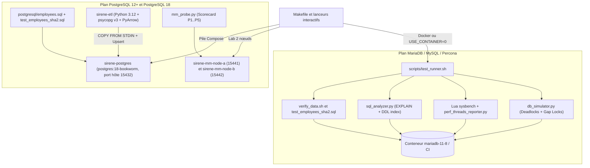
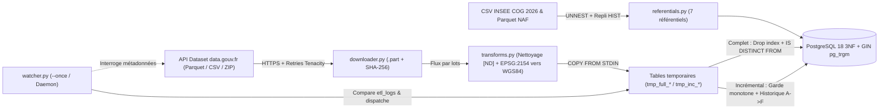

# Architecture plateforme et ETL

**test_db** réunit une suite de régression relationnelle multi-moteurs (`employees`, `sakila`) avec une plateforme ETL
**PostgreSQL 18** en troisième forme normale (3NF) et un laboratoire de qualification multi-maître (`sirene/`).

## 1. Topologie de plateforme multi-moteurs

La plateforme sépare les **jeux de données canoniques**, les **contrats de sommes de contrôle agnostiques** et les
**orchestrateurs** sur deux plans d'exécution distincts :

## 2. Pipeline ETL PostgreSQL 18 3NF Sirene

Le sous-système `sirene/` transforme les fichiers stock et delta `data.gouv.fr` vers un schéma relationnel à 13 tables
tout en préservant l'idempotence, l'intégrité référentielle historique et l'historique monotone des états.

### Rôles architecturaux clés

- **Staging vérifié (`downloader.py`)** : écriture en fichiers `.part` par blocs de `1 Mio` avec hachage SHA-256.
- **Protection référentielle (`referentials.py`)** : enregistre dynamiquement les codes historiques (`HIST`) et clés
  sentinelles (`UNK`, `UNK00`, `99100`, `00.00Z`, `0000`, `NN`, `UN`) pour éviter tout rejet `23503`.
- **Transformation uniforme (`transforms.py`)** : gère Parquet ZSTD et CSV zippés par lots de `50 000` lignes avec
  conversion Lambert-93 (`EPSG:2154`) vers `WGS84`.
- **Chemins complet vs incrémental** : l'import complet supprime et reconstruit `25` index secondaires autour de
  `COPY FROM STDIN`, tandis que l'import incrémental valide son préambule avant `with conn.transaction():` (`RCA-004`).

## Références et guides associés

- [Matrice des jeux de données et schémas](../../03-reference/architecture-specs/matrice-jeux-donnees-et-schemas.md)
- [Catalogue des scripts CLI et SQL](../../03-reference/cli-et-scripts/catalogue-scripts-cli-et-sql.md)
- [ADR-001 : ETL Sirene PostgreSQL 18 3NF et qualification MM](../decisions-architecture/adr-001-postgresql18-3nf-sirene-etl-et-qualification-mm.md)
- [Exécuter l'ETL Sirene complet et incrémental](../../02-guides-pratiques/exploitation/executer-etl-sirene-complet-et-incremental.md)
