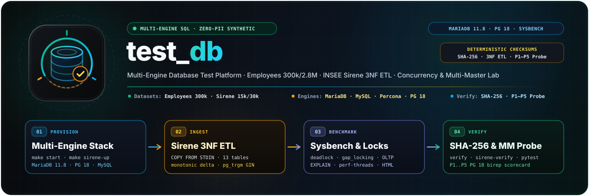

  

# test_db — Plateforme de tests multi-moteurs et ETL Sirene PostgreSQL 18 3NF

`test_db` (`v1.12.0`) réunit la suite canonique `employees` (MariaDB, MySQL, Percona, PostgreSQL), le reporting
automatisé `sysbench` et `EXPLAIN`, ainsi qu'une plateforme ETL PostgreSQL 18 3NF et de qualification multi-maître
pour le répertoire INSEE Sirene (`sirene/`). Le portail publié est accessible sur
[https://test-db.lightpath.fr/fr/](https://test-db.lightpath.fr/fr/).

  

    4 Moteurs
    MariaDB 11.8 · MySQL · Percona · PostgreSQL 18
  

  

    300k + 30k Lignes
    Employees (2,8M salaires) &amp; Sirene 3NF synthétique
  

  

    13 Tables PG18
    7 Référentiels · 3 GIN pg_trgm · 5 Sondes MM
  

  

    75+ SQL &amp; Contrôles
    60 Requêtes Employees + 15 Sirene · SHA-256 vérifié
  

[Démarrer les tutoriels](01-tutoriels/index.md){ .md-button .md-button--primary }
[Consulter les guides pratiques](02-guides-pratiques/index.md){ .md-button }
[Explorer la référence](03-reference/index.md){ .md-button }
[Lire les explications](04-explications/index.md){ .md-button }

---

## Matrice documentaire Diátaxis (Action × Cognition)

`test_db` structure sa documentation française selon les quatre quadrants Diátaxis pour séparer apprentissage guidé,
procédures opérationnelles, spécifications neutres et explications d'architecture :

| | **Pratique (Action)** | **Théorique (Cognition)** |
| :--- | :--- | :--- |
| **Acquisition (Apprendre)** | [**1. Tutoriels (`01-tutoriels/`)**](01-tutoriels/index.md) Labs Docker isolés pas à pas pour MariaDB Employees, Sirene PG 18 et Sysbench | [**4. Explications (`04-explications/`)**](04-explications/index.md) Topologie de plateforme, verrous InnoDB/PG18 et dossiers ADR |
| **Application (Travailler)** | [**2. Guides pratiques (`02-guides-pratiques/`)**](02-guides-pratiques/index.md) Procédures ASD-STF100 pour déploiement, ETL, qualification MM, incidents et sécurité | [**3. Référence (`03-reference/`)**](03-reference/index.md) Schémas 3NF, cibles Makefile, variables, catalogue CLI/SQL et matrice RCA |

---

## Explorer la documentation par quadrant

-   :material-school-outline:{ .lg .middle } **1. Tutoriels (`01-tutoriels/`)**

    ---

    *Pratique · Apprentissage* — Exécutez des labs Docker isolés couvrant l'injection `employees` sous MariaDB 11.8,
    le jeu synthétique Sirene PostgreSQL 18 hors ligne, Sysbench et les expériences de deadlocks.

    - [Index du quadrant Tutoriels](01-tutoriels/index.md)
    - [Tutoriel 1 : Bac à sable MariaDB 11.8 Employees](01-tutoriels/01-bac-a-sable-mariadb-employees.md)
    - [Tutoriel 2 : Lab Sirene PostgreSQL 18 hors ligne](01-tutoriels/02-lab-sirene-postgresql18-hors-ligne.md)
    - [Tutoriel 3 : Lab Concurrence et Benchmarks](01-tutoriels/03-lab-concurrence-et-benchmarks.md)

-   :material-wrench-outline:{ .lg .middle } **2. Guides pratiques (`02-guides-pratiques/`)**

    ---

    *Pratique · Exploitation* — Appliquez des procédures normalisées **ASD-STF100** pour le déploiement des conteneurs,
    l'analyse SQL, les imports Sirene, les sondes multi-maître, la remédiation d'incidents et les contrôles SHA-256.

    - [Index du quadrant Guides pratiques](02-guides-pratiques/index.md)
    - [Déployer les piles MariaDB et PostgreSQL](02-guides-pratiques/deploiement/deployer-piles-mariadb-et-postgresql.md)
    - [Exécuter Sysbench et l'analyse SQL](02-guides-pratiques/exploitation/executer-sysbench-et-analyse-sql.md)
    - [Exécuter l'ETL Sirene complet et incrémental](02-guides-pratiques/exploitation/executer-etl-sirene-complet-et-incremental.md)
    - [Qualifier PostgreSQL 18 multi-maître](02-guides-pratiques/exploitation/qualifier-postgresql18-multimaitre.md)
    - [Remédier aux deadlocks, gap locks et dérives ETL](02-guides-pratiques/gestion-incidents/remedier-deadlocks-gap-locks-et-derive-etl.md)
    - [Vérifier les sommes de contrôle et la confidentialité](02-guides-pratiques/securite/verifier-sommes-controle-et-confidentialite.md)

-   :material-table-search:{ .lg .middle } **3. Référence (`03-reference/`)**

    ---

    *Théorique · Consultation* — Consultez les schémas exacts (`employees`, `sakila`, Sirene 3NF 13 tables), les cibles
    `Makefile`, les variables d'environnement, les options CLI/SQL et les codes d'erreur RCA.

    - [Index du quadrant Référence](03-reference/index.md)
    - [Matrice des jeux de données et schémas](03-reference/architecture-specs/matrice-jeux-donnees-et-schemas.md)
    - [Variables d'environnement et cibles Makefile](03-reference/configuration/variables-environnement-et-cibles-makefile.md)
    - [Catalogue des scripts CLI et SQL](03-reference/cli-et-scripts/catalogue-scripts-cli-et-sql.md)
    - [Matrice des erreurs et alertes](03-reference/codes-erreurs/matrice-erreurs-et-alertes.md)

-   :material-lightbulb-outline:{ .lg .middle } **4. Explications (`04-explications/`)**

    ---

    *Théorique · Compréhension* — Comprenez la topologie multi-moteurs, la conception du pipeline Sirene 3NF, les
    mécanismes de verrouillage InnoDB/PostgreSQL et les dossiers d'architecture ADR.

    - [Index du quadrant Explications](04-explications/index.md)
    - [Architecture plateforme et ETL](04-explications/vue-architecture/architecture-plateforme-et-etl.md)
    - [ADR-001 : ETL Sirene PostgreSQL 18 3NF et qualification MM](04-explications/decisions-architecture/adr-001-postgresql18-3nf-sirene-etl-et-qualification-mm.md)
    - [ADR-002 : Architecture Diátaxis et publication MkDocs](04-explications/decisions-architecture/adr-002-diataxis-et-publication-mkdocs-versionnee.md)
    - [Compromis concurrence, verrouillage et réplication](04-explications/analyses-internes/compromis-concurrence-verrous-et-replication.md)

-   :material-book-open-variant:{ .lg .middle } **Guides techniques &amp; HTML interactif**

    ---

    Accédez à la présentation générale en français, au guide rapide du module Sirene, aux manuels techniques en
    français et à l'explorateur HTML5 interactif Sirene.

    - [Aperçu du dépôt (FR)](../../README_fr.md)
    - [Démarrage rapide du module Sirene](../../sirene/README.md)
    - [Index des guides techniques (FR)](../../documentation/fr/index.md)
    - [Référence HTML interactive Sirene](../../documentation/sirene_documentation.html)
    - [Guide plateforme Sirene (FR)](../../documentation/fr/sirene_platform.md)
    - [60 requêtes SQL Employees (FR)](../../doc_employees/employees_fr.md)

-   :material-history:{ .lg .middle } **Versions et gouvernance**

    ---

    Suivez les versions publiées, les journaux d'ingénierie en anglais et le portail publié sur
    [test-db.lightpath.fr](https://test-db.lightpath.fr/fr/).

    - [Changelog (`Changelog`)](../../Changelog)
    - [Journal d'actions (`ACTION_LOGBOOK.md`)](../ACTION_LOGBOOK.md)
    - [Registre RCA (`RCA_REGISTER.md`)](../RCA_REGISTER.md)
    - [Portail publié (`test-db.lightpath.fr`)](https://test-db.lightpath.fr/fr/)

