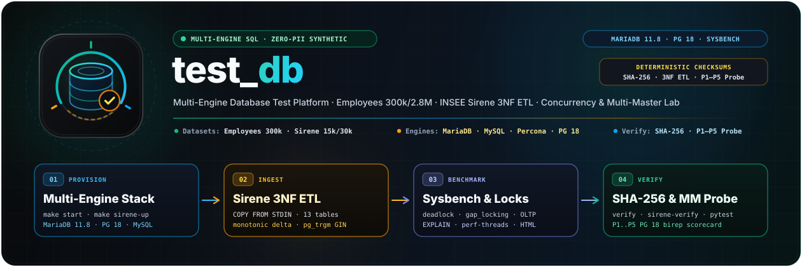

  

# test_db — Multi-Engine Database Test Platform &amp; Sirene PostgreSQL 18 3NF ETL

`test_db` (`v1.12.0`) combines the canonical MariaDB/MySQL/Percona/PostgreSQL `employees` benchmark suite, automated
`sysbench` concurrency and `EXPLAIN` reporting, and a PostgreSQL 18 3NF ETL and multi-master qualification platform for
the INSEE Sirene business registry (`sirene/`). Published documentation lives at
[https://test-db.lightpath.fr/](https://test-db.lightpath.fr/).

  

    4 Engines
    MariaDB 11.8 · MySQL · Percona · PostgreSQL 18
  

  

    300k + 30k Rows
    Employees (2.8M Salaries) &amp; Synthetic Sirene 3NF
  

  

    13 PG18 Tables
    7 Referentials · 3 pg_trgm GIN · 5 MM Probes
  

  

    75+ SQL &amp; Checks
    60 Employees + 15 Sirene Queries · SHA-256 Verified
  

[Start Tutorials](01-tutorials/index.md){ .md-button .md-button--primary }
[Browse How-To Guides](02-how-to-guides/index.md){ .md-button }
[Inspect Reference](03-reference/index.md){ .md-button }
[Read Explanation](04-explanation/index.md){ .md-button }

---

## Diátaxis Documentation Matrix (Action × Cognition)

`test_db` organizes technical documentation across the four Diátaxis quadrants so every page serves one clear goal
without mixing guided lessons, operational procedures, reference tables, and architectural explanations:

| | **Practical (Action)** | **Theoretical (Cognition)** |
| :--- | :--- | :--- |
| **Acquisition (Study)** | [**1. Tutorials (`01-tutorials/`)**](01-tutorials/index.md) Guided isolated Docker sandboxes for MariaDB Employees, Sirene PG 18, and Sysbench labs | [**4. Explanation (`04-explanation/`)**](04-explanation/index.md) Platform topology, InnoDB/PG18 locking internals, and Architecture Decision Records |
| **Application (Work)** | [**2. How-To Guides (`02-how-to-guides/`)**](02-how-to-guides/index.md) Goal-oriented ASD-STE100 Issue 9 deployment, ETL, probe, incident, and security SOPs | [**3. Reference (`03-reference/`)**](03-reference/index.md) Exhaustive dataset schemas, Makefile targets, environment variables, CLI flags, and RCA matrices |

---

## Explore Documentation by Quadrant

-   :material-school-outline:{ .lg .middle } **1. Tutorials (`01-tutorials/`)**

    ---

    *Practical · Study / Acquisition* — Follow reproducible isolated Docker lessons covering MariaDB 11.8 `employees`
    injection, Sirene PostgreSQL 18 offline synthetic datasets, Sysbench scaling, and deadlock labs.

    - [Tutorials Quadrant Index](01-tutorials/index.md)
    - [Tutorial 1: MariaDB 11.8 Employees Sandbox](01-tutorials/01-mariadb-employees-sandbox.md)
    - [Tutorial 2: Sirene PostgreSQL 18 Offline Lab](01-tutorials/02-sirene-postgresql18-offline-lab.md)
    - [Tutorial 3: Concurrency and Benchmarking Lab](01-tutorials/03-concurrency-and-benchmarking-lab.md)

-   :material-wrench-outline:{ .lg .middle } **2. How-To Guides (`02-how-to-guides/`)**

    ---

    *Practical · Work / Application* — Execute ASD-STE100 Issue 9 operational procedures for container deployment,
    Sysbench and SQL analysis, Sirene ETL runs, multi-master probing, incident recovery, and checksum verification.

    - [How-To Guides Quadrant Index](02-how-to-guides/index.md)
    - [Deploy MariaDB and PostgreSQL Stacks](02-how-to-guides/deployment/deploy-mariadb-and-postgresql-stacks.md)
    - [Run Sysbench and SQL Analysis](02-how-to-guides/operations/run-sysbench-and-sql-analysis.md)
    - [Run Sirene Full and Incremental ETL](02-how-to-guides/operations/run-sirene-full-and-incremental-etl.md)
    - [Qualify PostgreSQL 18 Multi-Master](02-how-to-guides/operations/qualify-postgresql18-multimaster.md)
    - [Remediate Deadlocks, Gap Locks, and ETL Drift](02-how-to-guides/incident-response/remediate-deadlocks-gap-locks-and-etl-drift.md)
    - [Verify Checksums and Privacy Boundaries](02-how-to-guides/security/verify-checksums-and-privacy-boundaries.md)

-   :material-table-search:{ .lg .middle } **3. Reference (`03-reference/`)**

    ---

    *Theoretical · Work / Application* — Look up exact table schemas (`employees`, `sakila`, 13-table Sirene 3NF),
    `Makefile` targets, environment variables, Python/Bash CLI flags, SQL catalogs, and RCA error matrices.

    - [Reference Quadrant Index](03-reference/index.md)
    - [Datasets and Schemas Matrix](03-reference/architecture-specs/datasets-and-schemas-matrix.md)
    - [Environment Variables and Makefile Targets](03-reference/configuration/environment-variables-and-makefile-targets.md)
    - [CLI Scripts and SQL Catalog](03-reference/cli-and-scripts/cli-scripts-and-sql-catalog.md)
    - [Error and Alert Matrix](03-reference/troubleshooting-codes/error-and-alert-matrix.md)

-   :material-lightbulb-outline:{ .lg .middle } **4. Explanation (`04-explanation/`)**

    ---

    *Theoretical · Study / Acquisition* — Understand the multi-engine architecture, Sirene 3NF pipeline design,
    InnoDB wait-for-graph deadlocks, gap locking, PostgreSQL advisory locks, and Architecture Decision Records.

    - [Explanation Quadrant Index](04-explanation/index.md)
    - [Platform and ETL Architecture](04-explanation/architecture-overview/platform-and-etl-architecture.md)
    - [ADR-001: PostgreSQL 18 3NF Sirene ETL &amp; MM Qualification](04-explanation/design-decisions/adr-001-postgresql18-3nf-sirene-etl-and-mm-qualification.md)
    - [ADR-002: Diátaxis Versioned MkDocs Publishing](04-explanation/design-decisions/adr-002-diataxis-versioned-mkdocs-publishing.md)
    - [Concurrency, Locking, and Replication Trade-offs](04-explanation/deep-dives/concurrency-locking-and-replication-tradeoffs.md)

-   :material-translate:{ .lg .middle } **Bilingual EN / FR Guides &amp; Interactive HTML**

    ---

    Access synchronized English and French repository overviews, the Sirene module quickstart, bilingual technical
    manuals, and the self-contained interactive Sirene HTML schema and SQL explorer.

    - [Repository Overview (EN)](../README.md)
    - [Repository Overview (FR)](../README_fr.md)
    - [Sirene Module Quickstart](../sirene/README.md)
    - [Technical Guides Index (EN)](../documentation/en/index.md)
    - [Technical Guides Index (FR)](../documentation/fr/index.md)
    - [Sirene Interactive HTML Reference](../documentation/sirene_documentation.html)
    - [Sirene Platform Guide (EN)](../documentation/en/sirene_platform.md)
    - [Sirene Platform Guide (FR)](../documentation/fr/sirene_platform.md)
    - [Employees SQL Reference (EN)](../doc_employees/employees.md)
    - [Employees SQL Reference (FR)](../doc_employees/employees_fr.md)

-   :material-history:{ .lg .middle } **Releases &amp; Governance**

    ---

    Track versioned releases, living engineering traceability logs, root-cause analyses, and the live published
    documentation portal at [test-db.lightpath.fr](https://test-db.lightpath.fr/).

    - [Changelog (`Changelog`)](../Changelog)
    - [Action Logbook (`ACTION_LOGBOOK.md`)](ACTION_LOGBOOK.md)
    - [RCA Register (`RCA_REGISTER.md`)](RCA_REGISTER.md)
    - [Published Portal (`test-db.lightpath.fr`)](https://test-db.lightpath.fr/)

